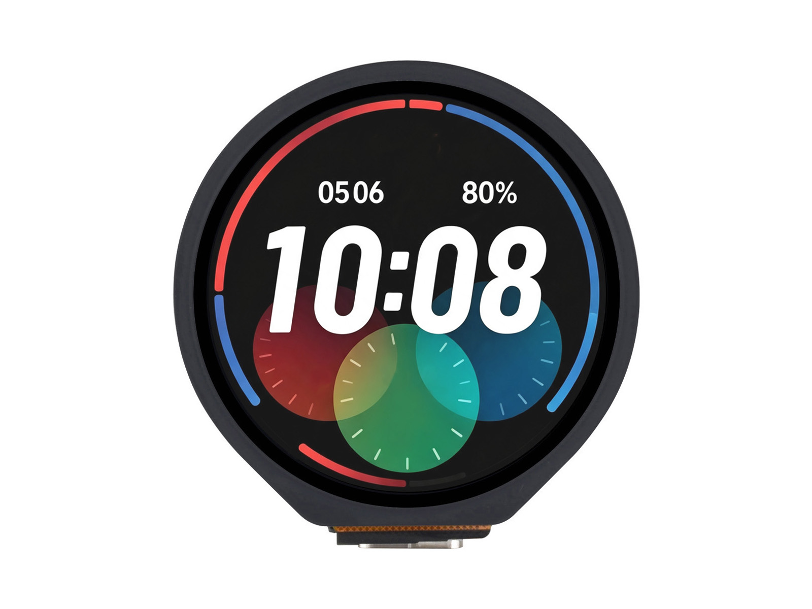

# Waveshare ESP32-C6-Touch-LCD-1.28

[中文](README_ZH.md)

The ESP32-C6-Touch-LCD-1.28 is a low-cost, high-performance microcontroller development board designed by Waveshare. In a small form factor, it integrates a 1.28-inch capacitive touch LCD screen, a lithium-ion battery charging chip, and six-axis sensors (a three-axis accelerometer and a three-axis gyroscope), facilitating development and integration into products.

- [Purchase Link](https://www.waveshare.com/ESP32-C6-Touch-LCD-1.28.htm)
- [Documentation](https://docs.waveshare.com/ESP32-C6-Touch-LCD-1.28)



## Repository Structure

This repository provides sample programs, bundled Arduino libraries, factory firmware, and hardware design files for the ESP32-C6-Touch-LCD-1.28.

```
.
├── assets/                # Product images used in the README
├── examples/              # Sample programs
│   ├── Arduino/           # Arduino sketches and bundled libraries
│   └── ESP-IDF/           # ESP-IDF projects
├── firmware/              # Pre-built factory firmware (.bin)
├── hardware/              # Schematics, pinout, and dimension drawings
└── HARDWARE_REFERENCE.md  # Hardware quick reference
```

## Getting Started

Pre-built firmware is available in [`firmware/`](firmware). For build environments, flashing steps, pin mappings, and configuration, refer to the [documentation page](https://docs.waveshare.com/ESP32-C6-Touch-LCD-1.28).

For a structured hardware reference designed for both developers and AI coding assistants — covering onboard peripherals, GPIO assignments, I2C addresses, and expansion interface signals — see [HARDWARE_REFERENCE.md](HARDWARE_REFERENCE.md).

## Contributing

We welcome contributions! Here's how you can help:

1. Fork the repository.
2. Create a new branch for your feature or bug fix.
3. Commit your changes with clear descriptions.
4. Submit a pull request for review.

## Issues and Support

Open an [issue](https://github.com/waveshareteam/ESP32-C6-Touch-LCD-1.28/issues) with detailed information, or contact the Waveshare team with your order number for technical support.

## License

Licensed under the Apache License 2.0. See the [LICENSE](LICENSE) file for details.

---

Thank you for using Waveshare Electronics Products! 🚀
